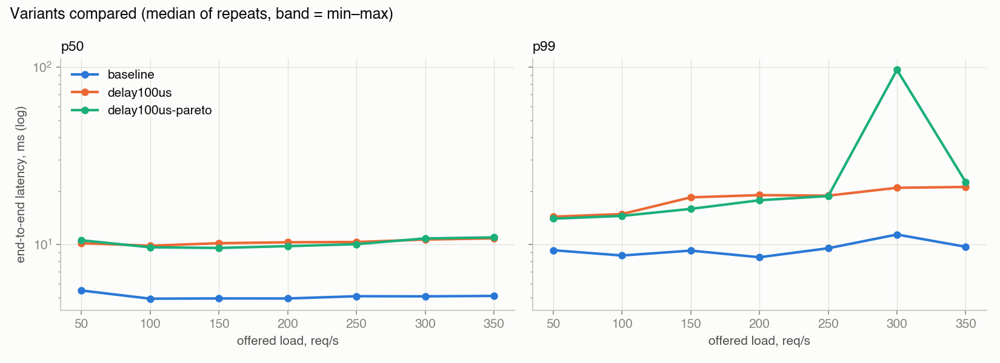
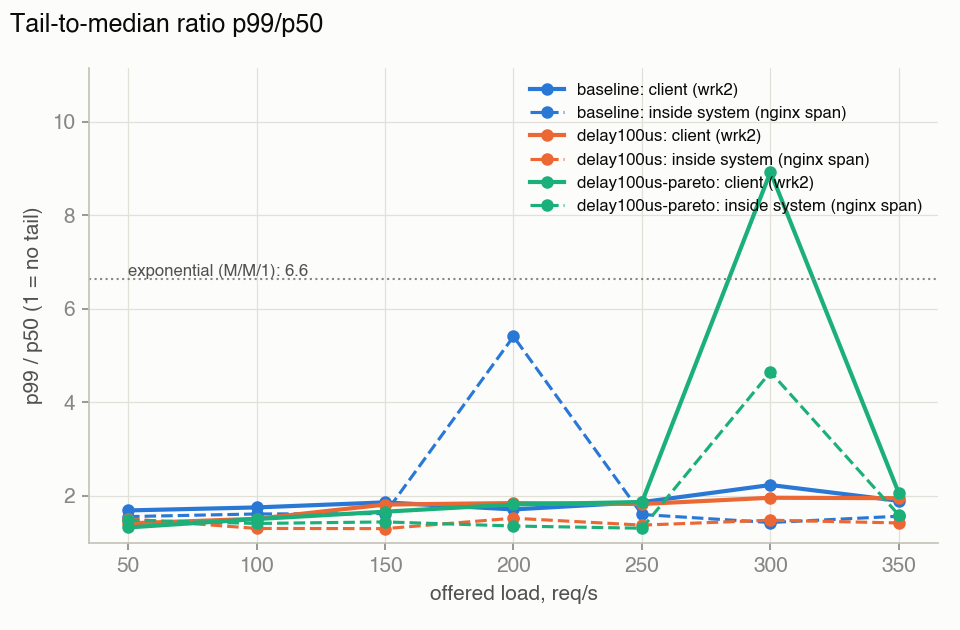
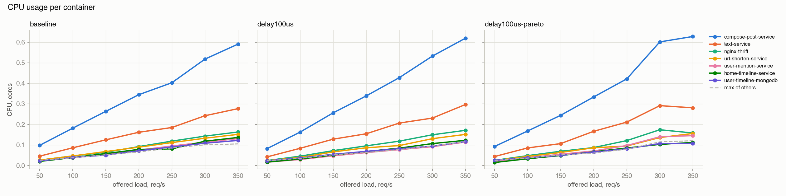
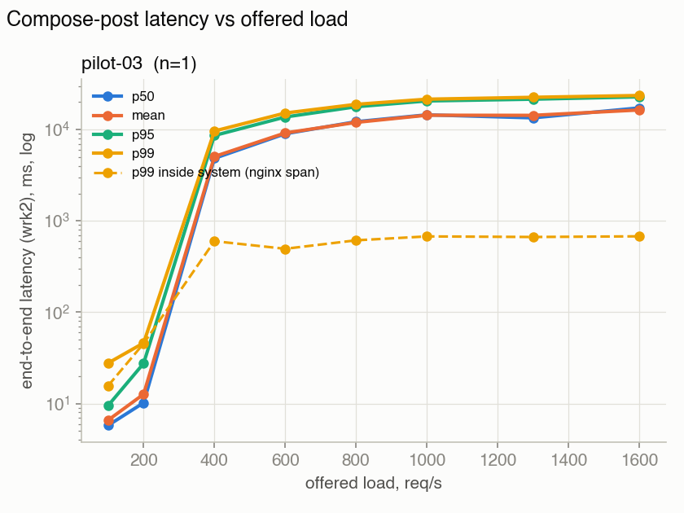

# Контрольная точка 1

- [Описание проекта](../project.md)
- [План эксперимента](../experiment-plan.md)

## Краткий итог

Выбран технический путь: использование и доработка авторского артефакта.
Проверена сборка авторского артефакта, работа его компонент из коробки, определены направления, где потребуются доработки.
Проведены независимые технические проверки на локальных машинах, для ограниченных графов сервисов, 
через которые проходят запросы `compose-post` и `read-user-timeline`, а также предварительные эксперименты
для этих графов.

## Технические проверки

Из двух предложенных в задании сервисов был выбран `socialNetwork`, так как для него приводятся несколько экспериментов и выводов
в статье, с которыми можно будет сверить полученные результаты. Выбран самый маленький из трех датасетов
(социальных графов) в бенчмарке (~900 нод, ~37000 связей).

Зависимости:
```
docker
docker-compose
asyncio
aiohttp
libssl-dev
libz-dev
luarocks
luasocket
luajit
```

### Базовые проверки

Запускать из `DeathStarBench/socialNetwork/`.

Пересборка авторских контейнеров из исходников:
```bash
docker build -t deathstarbench/social-network-microservices:latest
```

Подъем сервисов:
```bash
docker compose up -d
```

Генерация нагрузки с фиксированной частотой:
```bash
../wrk2/wrk -D exp -t 12 -c 100 -T 30s -s ./wrk2/scripts/social-network/read-user-timeline.lua http://localhost:8080/wrk2-api/user-timeline/read -d 60 -R 2000
../wrk2/wrk -D exp -t 12 -c 100 -T 30s -s ./wrk2/scripts/social-network/compose-post.lua http://localhost:8080/wrk2-api/post/compose -d 60 -R 200
```

После этого трейсы `jaeger` можно посмотреть на `localhost:16686`. С `:latest` версией контейнера, указанной в авторском
`docker-compose.yml`, `jaeger` не поднимался, версия была изменена на `:1.62.0` - трейсы отображаются корректно.

Выключение сервисов с очисткой баз:
```bash
docker compose down --volumes
```

### Предварительные эксперименты с compose-post
Окружение: ноутбук на Intel Core i9-9880H (8 ядер, 16 потоков), 16 ГБ памяти, macOS 26.
Проводились в VM в `colima`. Сетевые задержки были добавлены в эксперименты с помощью `netem`.

Тяжелый write запрос с записью в несколько баз.

Был использован авторский генератор нагрузки со скриптом compose-post.
В экспериментах 1-3 перед каждым запуском генератора нагрузки с новым RPS базы очищались, в 4 - нет.

1. Зависимость p50 и p99 latency от RPS без сетевой задержки, с константной сетевой задержкой и задержкой с распределением Парето.


2. Отношение tail-to-median в зависимости от RPS.


3. Нагрузки каждого сервиса на CPU в зависимости от сетевых задержек.


4. Задержка в зависимости от RPS при постепенно увеличивающейся нагрузке.


### Предварительные эксперименты с read-user-timeline
Окружение: ноутбук на 13th Intel Core i7-1355U (10 ядер, 12 потоков), 16 ГБ памяти, ubuntu 24.04.1.

Легкий read запрос, затрагивающий ограниченный граф сервисов.

Был использован авторский генератор нагрузки со скриптом read-user-timeline без предварительного заполнения баз.
В эксперименте рассматривалась зависимость p50 и p99 latency от RPS при экспоненциальном росте с шагом 1.1.
На замер для каждого RPS было 60 секунд, между замерами добавлялось 30 секунд сна, чтобы дать системе разгрузиться.


### Полученные результаты и выводы

1. wrk2 плохо подходит для генерации требуемой в задании постепенно увеличивающейся нагрузки: один запуск
имеет фиксированное значение RPS, а также проводит 10 секундную калибровку по задержкам перед генерацией основой
нагрузки. Также он выдает мало инфорамации о потерянных запросах, таймаутах и других отказах, из-за чего
вычисляемым им статистикам latency напрямую верить нельзя.

2. Узким местом является не отдельный сервис, а все доступное cpu ноутбука/VM в целом. Результаты экспериментов 
сильно зависят от остальной нагрузки на машине, что было подтверждено в технических проверках обеих запросов.
В графиках эксприментов с compose-post видно просадки от сторонней активности. В экспериментах с read-user-timeline
для получения возврастающего графика потребовалось не трогать ноутбук в течении бенчмарка.

3. С помощью netem удается добавить искусственные сетевые задержки, они влияют на результаты.

## Ресурсы

Была проведены проверки в локальных конфигруациях на Linux и MacOS (точные конфигурации описаны ранее), найдены примерные RPS 
насыщения для двух проверяемых запросов: 300 для `compose-post` и 5000 для `read-user-timeline`.
Ограниченные графы поднимают 11 и 3 сервиса соответственно. 
Проведен замер потребляемого генератором нагрузки cpu для `compose-post`: при 350 RPS занимает 0,1 ядра из 2, поэтому
ожидается, что генератор бутылочным горлыжком не будет.

## Риски и следующие шаги

1. Реализовать новый генератор нагрузки, поддерживающий постепенное увеличение RPS.
2. Добавить сбор метрик latency с каждого сервиса, так как просмотра отдельных трасс
jaeger недостаточно для полноценной диагностики.
3. Улучшить воспроизводимость таймингов. Научиться контролировать доступные сервисам
ресурсы: самый простой вариант - `resources` и `cpuset` в docker-compose, однако можно попробовать
реализовать более сложные решения для динамического изменения.
4. Общий стенд для бенчмарков, замеры на отдельной VM.
5. Донести код в репозиторий - пока большинство экспериментов были локальными.

## Ответственность участников

### Участник: Бельский Артем

- Согласованная ответственность за период: технические проверки и эксперименты с compose-post;
- Полученный результат и ссылки на материалы: описаны в секции "Технические проверки";
- Следующая ответственность: TODO.

### Участник: Кривецкий Илья

- Согласованная ответственность за период: добавление сетевых задержек в эксперименты с compost-post, планирование дальнейшей работы;
- Полученный результат и ссылки на материалы: описаны в секциях "Технические проверки", "Описание проекта", "План эксперимента";
- Следующая ответственность: TODO.

### Участник: Родионов Валерий

- Согласованная ответственность за период: технические проверки и эксперименты с read-user-timeline, работа с репозиторием;
- Полученный результат и ссылки на материалы: описаны в секции "Технические проверки";
- Следующая ответственность: TODO.
